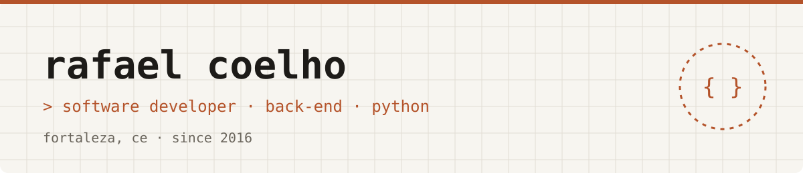

<picture>
  <source media="(prefers-color-scheme: dark)" srcset="banner-dark.svg">
  
</picture>

### Now

Software developer at **Getrônics**, in a squad building AI products for
document processing, with Python and FastAPI.

### Latest posts

- `Oct 2026`
  [The LLM reads, the code checks: a self-correction loop](https://rafaellcoellho.com/en/2026/10/11/the-llm-reads-the-code-checks/)
- `Oct 2022`
  [Using argparse, tox and setuptools to build a Python CLI app](https://rafaellcoellho.com/en/2022/10/16/argparse-tox-setuptools-python-cli-app/)
- `Feb 2022`
  [Makefile as a Command Runner](https://rafaellcoellho.com/en/2022/02/26/makefile-as-command-runner/)
